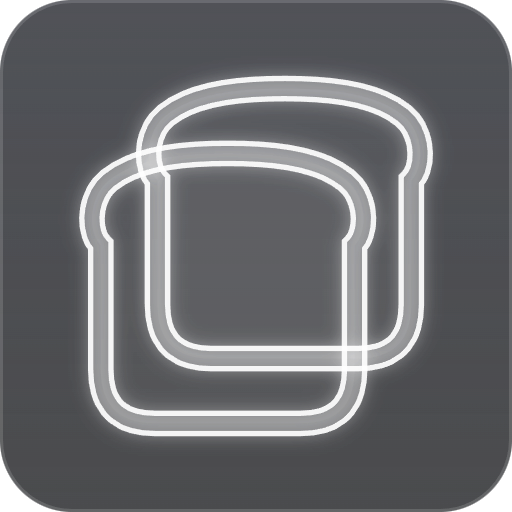

# Pane

Local and network web apps as desktop apps. Pane scans the machine for
listening HTTP servers, shows them as app icons, and opens each one in a tab
or in a window of its own, each with its own cookie store. Any app can be
detached into a standalone app with its own launcher entry. Dev servers can be
stopped from the UI so stray processes stay visible.

Pane used to be called AppBrowser; on first start it copies the old settings
(`~/.config/appbrowser`) over. The OS keyring may tie saved passwords to the
old name; any that no longer decrypt are skipped and offered for saving again
at the next login.

## Run from source

```sh
npm install
npm start
```

If you launch it from a VS Code terminal and it crashes with
`Cannot read properties of undefined (reading 'handle')`, the terminal has
`ELECTRON_RUN_AS_NODE=1` set, which makes Electron behave like plain Node:

```sh
env -u ELECTRON_RUN_AS_NODE npm start
```

## Build a single file

```sh
npm run dist:linux   # dist/Pane-<version>.AppImage
npm run dist:win     # dist/Pane-<version>.exe (portable single exe)
```

The Windows build runs on Linux without Wine: electron-builder's rcedit step is
off (`win.signAndEditExecutable`), and `scripts/win-exe-resources.js` writes the
exe's icon and version info with resedit instead. The exe is not code-signed,
so Windows SmartScreen asks once before the first start.

The portable exe unpacks the whole app to `%TEMP%` on every start, which is
slow. So on its first run it installs a copy of itself to
`%LOCALAPPDATA%\Programs\Pane\app-<version>` and adds a "Pane" Start menu
entry; standalone apps are pointed at that copy too, and both start without
unpacking (`src/main/install.js`). Running a newer portable exe installs that
version and removes the old one. To uninstall, delete that folder and the
Start menu entries.

The app icon is generated from code: `npm run icons` writes
`src/assets/icon.svg`, `icon.png` and `icon.ico` from `scripts/icons.js`.

AppImages need `libfuse2`. Debian 13 ships only fuse3, so either install
`libfuse2t64` or start it with `./Pane-<version>.AppImage --appimage-extract-and-run`.

## How it works

- `src/main/scanner.js` lists listening TCP ports with the owning process
  (`ss -tlnp` and `/proc` on Linux, `netstat -ano` and `tasklist` on Windows).
- `src/main/probe.js` sends one GET to `/` per port and classifies the answer:
  HTML with a 2xx/3xx status is a web app, JSON is an API, an HTML 404 is a
  backend with no frontend. Ports are rescanned every 2 s; confirmed web apps
  are re-probed every 30 s, everything else every 5 s so a server that is still
  starting up gets promoted once it answers properly.
- `src/main/main.js` owns the windows, one `WebContentsView` per app (partition
  `persist:app-<port>`, sandboxed), the native menus and the keyboard shortcuts.
  An app lives either as a tab in the main window or in its own window
  (`src/renderer/frame.html`: a slim title strip in the app's color). A view is
  moved between the two, so the page keeps its state.
- Home is a launcher: icons (favicons fetched by `src/main/icons.js`, or a
  colored letter), one search field that filters apps and adds a network
  address on Enter. Everything else sits behind right-click: open in own
  window / always open in own window, rename, copy address, open in system
  browser, open folder in VS Code, hide, Stop (asks first, then SIGTERM to the
  process tree via `tree-kill`). Background services (JSON or HTML error pages
  at `/`), hidden entries and saved logins are in the Manage dialog behind the
  footer links.
- The chrome samples the top 6 pixel rows of the visible app every 1.5 s and
  after each load, and tints the tab bar or title strip to the page's color,
  so the app seems to own the window. The window title follows the app.
- When a page fails to load (server stopped), the tab shows "isn't responding"
  instead of a blank page and reloads by itself as soon as the scanner sees
  the server again.
- Home has two layouts, switched at the bottom right or by right-clicking an
  empty spot: Grid (small centered icons) and Previews (large cards with a
  screenshot). `src/main/thumbs.js` takes the screenshots while an app is on
  screen, or once in a hidden, muted window for apps never opened, and keeps
  them in `userData/thumbs`.
- "Detach as standalone app" (right-click a tile, tab or window title) writes a
  launcher entry with the app's name and icon: a `.desktop` file in
  `~/.local/share/applications` on Linux, a Start menu shortcut on Windows
  (`src/main/standalone.js`). It starts Pane with `--pane-app=<id>`, which
  opens only that app in its own window; if Pane already runs, the window
  opens there. On Windows the window also gets its own taskbar identity. The
  launcher icon is drawn by `rasterIcon` in `src/renderer/common.js`.
- `src/main/prefs.js` keeps custom names, apps that open in their own window,
  window positions, the home layout (grid or previews) and detached apps in
  `prefs.json` (userData).
- "Find network apps" (footer link, or right-click an empty spot on home)
  searches the local network once, on request: services announced over mDNS
  (`_http._tcp`, `_https._tcp`) and a sweep of common web ports (80, 443,
  3000, 5000, 8000, 8080, 8443, 8888) on this machine's /24 networks and on
  the networks of apps already added. Hits are named by mDNS or reverse DNS,
  otherwise by their page title; stock web server pages and apps already in
  the list are left out (`src/main/discover.js`).
- `src/main/netapps.js` keeps user-added network apps (for example
  `tools.local`) in `network-apps.json` under the Electron userData folder,
  probes them every 15 s following same-host redirects, and marks unreachable
  ones offline. They open in tabs with a cookie partition per host, and
  self-signed certificates on those hosts are accepted.
- `src/main/content-preload.js` runs sandboxed inside every tab. It autofills a
  saved login for the page's origin and, after a login form disappears or the
  URL changes, reports the typed credentials. `src/main/passwords.js` stores
  them in `credentials.json` (userData) encrypted with `safeStorage`, which
  uses the OS keyring; the main process asks before saving and only ever
  hands a password to the origin it was saved for. Saved logins can be
  forgotten in the Manage dialog.
- `src/main/hidden.js` remembers local entries the user hid, keyed by process
  name and port.
- Apps open in tabs, or in their own window if "Open apps in their own window"
  (right-click an empty spot on home) or the app's "Always open in own window"
  is set. Ctrl+click, middle-click or Ctrl+Enter opens an app the other way.
- Shortcuts: Ctrl+T home/search, Ctrl+W close, Ctrl+Tab / Ctrl+1…9 switch
  tabs, Alt+←/→ and the mouse thumb buttons navigate, Ctrl +/−/0 zoom, F5 and
  Ctrl+R reload, Ctrl+Shift+R and Ctrl+F5 hard reload (clears the app's HTTP
  cache, keeps cookies), F12 DevTools. On home, typing anywhere searches.
- The windows have no native frame: the tab bar (or title strip) is the title
  bar, and the OS window buttons are drawn on top of it in the app's colors
  via `titleBarOverlay`. Only one instance runs; starting it again focuses it.
- `src/renderer/` is the chrome: tab bar and launcher (`index.html`, `app.js`),
  app-window title strip (`frame.html`, `frame.js`), shared bits in `common.js`.

Dev aids: `PANE_AUTOOPEN=<port>[,<port>…]` opens those servers on start,
`PANE_SCREENSHOT=<file.png>` captures every window and the pages in them
(`<file>.tab.png`, `<file>.win<N>.png`) after `PANE_SCREENSHOT_DELAY` ms
and exits. `PANE_USER_DATA=<dir>` uses a separate profile, to test next to
a running instance.

## Roadmap

- Project list: register a folder plus command, launch it as a dev server from
  the app, and stop it by closing its tab (the app owns that process group).
- Find in page (Ctrl+F), reopen tabs and windows on start.
- Stop processes that are not owned by the current user (needs elevation).
