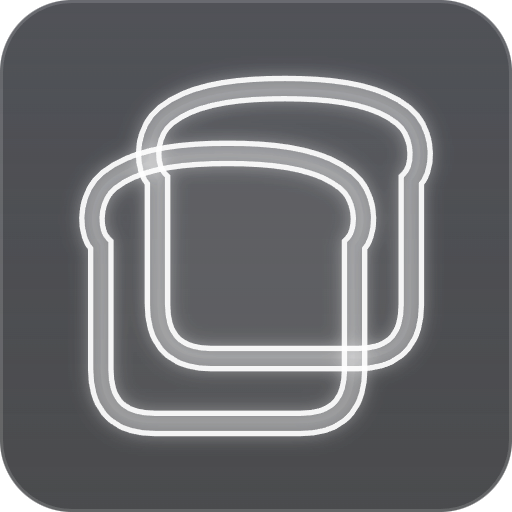

# Pane

Local and network web apps as desktop apps. Pane scans the machine for
listening HTTP servers, shows them as app icons, and opens each one in a tab
or in a window of its own, each with its own cookie store. Apps you pin stay on
top of the launcher even while their server is down, and a pinned local app
starts its server again with one click. A web app folder with a `pane.sh`
shows up even if it never ran on this machine, and starts with a click. Any app can be detached into a
standalone app with its own launcher entry. Servers can be stopped and
restarted from the UI so stray processes stay visible.

Pane used to be called AppBrowser; on first start it copies the old settings
(`~/.config/appbrowser`) over. The OS keyring may tie saved passwords to the
old name; any that no longer decrypt are skipped and offered for saving again
at the next login.

## Run from source

```sh
npm install
npm start
```

If you launch it from a VS Code terminal and it crashes with
`Cannot read properties of undefined (reading 'handle')`, the terminal has
`ELECTRON_RUN_AS_NODE=1` set, which makes Electron behave like plain Node:

```sh
env -u ELECTRON_RUN_AS_NODE npm start
```

## Build a single file

```sh
npm run dist:linux   # dist/Pane-<version>.AppImage
npm run dist:win     # dist/Pane-<version>.exe (portable single exe)
```

The Windows build runs on Linux without Wine: electron-builder's rcedit step is
off (`win.signAndEditExecutable`), and `scripts/win-exe-resources.js` writes the
exe's icon and version info with resedit instead. The exe is not code-signed,
so Windows SmartScreen asks once before the first start.

The portable exe unpacks the whole app to `%TEMP%` on every start, which is
slow. So on its first run it installs a copy of itself to
`%LOCALAPPDATA%\Programs\Pane\app-<version>` and adds a "Pane" Start menu
entry; standalone apps are pointed at that copy too, and both start without
unpacking (`src/main/install.js`). Running a newer portable exe installs that
version and removes the old one. To uninstall, delete that folder and the
Start menu entries.

The app icon is generated from code: `npm run icons` writes
`src/assets/icon.svg`, `icon.png` and `icon.ico` from `scripts/icons.js`.

AppImages need `libfuse2`. Debian 13 ships only fuse3, so either install
`libfuse2t64` or start it with `./Pane-<version>.AppImage --appimage-extract-and-run`.

## How it works

- `src/main/scanner.js` lists listening TCP ports with the owning process
  (`ss -tlnp` and `/proc` on Linux, `netstat -ano` and `tasklist` on Windows).
- `src/main/probe.js` sends one GET to `/` per port and classifies the answer:
  HTML with a 2xx/3xx status is a web app, JSON is an API, an HTML 404 is a
  backend with no frontend. Ports are rescanned every 2 s; confirmed web apps
  are re-probed every 30 s, everything else every 5 s so a server that is still
  starting up gets promoted once it answers properly.
- `src/main/main.js` owns the windows, one `WebContentsView` per app (partition
  `persist:app-<port>`, sandboxed), the native menus and the keyboard shortcuts.
  An app lives either as a tab in the main window or in its own window
  (`src/renderer/frame.html`: a slim title strip in the app's color). A view is
  moved between the two, so the page keeps its state.
- Home is a launcher: icons (favicons fetched by `src/main/icons.js`, or a
  colored letter), one search field that filters apps and adds a network
  address on Enter. Pinned apps ("Pin to top"; detached apps are pinned too)
  fill the middle; everything else found on this computer and the network is a
  compact list below them. Everything else sits behind right-click: open in own
  window / always open in own window, rename, copy address, open in system
  browser, open folder in VS Code, hide, Stop (asks first, then SIGTERM to the
  process tree via `tree-kill`). Background services (JSON or HTML error pages
  at `/`), hidden entries and saved logins are in the Manage dialog behind the
  footer links.
- The chrome samples the top 6 pixel rows of the visible app every 1.5 s and
  after each load, and tints the tab bar or title strip to the page's color,
  so the app seems to own the window. The window title follows the app.
- When a page fails to load (server stopped), the tab shows "isn't responding"
  instead of a blank page and reloads by itself as soon as the scanner sees
  the server again.
- Home has two layouts, switched at the bottom right or by right-clicking an
  empty spot: Grid (small centered icons) and Previews (large cards with a
  screenshot). `src/main/thumbs.js` takes the screenshots while an app is on
  screen, or once in a hidden, muted window for apps never opened, and keeps
  them in `userData/thumbs`.
- "Detach as standalone app" (right-click a tile, tab or window title) writes a
  launcher entry with the app's name and icon: a `.desktop` file in
  `~/.local/share/applications` on Linux, a Start menu shortcut on Windows
  (`src/main/standalone.js`). It starts Pane with `--pane-app=<id>`, which
  opens only that app in its own window; if Pane already runs, the window
  opens there. On Windows the window also gets its own taskbar identity. On
  Linux under Wayland, where windows have no icon of their own, the window is
  created with the launcher entry's name as its app id (Electron reads
  `CHROME_DESKTOP` per window), so GNOME and KDE show the app's icon and name
  in the dock and overview instead of Pane's; detaching or undetaching an open
  app recreates its window for that. The
  launcher icon is drawn by `rasterIcon` in `src/renderer/common.js`.
- A pinned app stays on home while its server is down. For a local one Pane
  remembers the executable, arguments and folder it was last seen running with
  (from `/proc`, so Linux only), and clicking it starts the server again
  (`src/main/launch.js`): detached from Pane, under its original process name,
  without Pane's open file descriptors, output in `userData/logs`. The tab
  shows "Starting…" until the server answers. Running servers have "Restart
  server" in their menu.
- Apps with a `pane.sh` (see below) are found by `src/main/paneapps.js`: it
  looks for `<root>/*/pane.sh` and `<root>/*/*/pane.sh` (not deeper, and not
  into `node_modules`, `venv`, `dist`, `out` or dot folders such as `.git`)
  at start, every 60 s, when the main window gets focus and when "Find network
  apps" runs. The roots are `~/Dokumente`, `~/Documents`, `~/Projects` and
  `~/src` where they exist, plus the parent folders of the working folders of
  local servers Pane has seen (inside the home folder only; remembered in
  `prefs.json` as `serverFolders`). To search other folders instead of the
  default ones, set `"appFolders": ["~/work", "/srv/apps"]` in `prefs.json`
  (while Pane is closed). Each app is a tile on home also while its server is
  down; clicking it runs its `pane.sh` from its folder the same way a pinned
  app is started (detached, file descriptors closed, output in
  `userData/logs`, "Starting…" until the port answers). A server listening
  on the app's port, in the app's folder (or the process Pane started for it),
  is that app: one tile, known by the folder (`pane:<folder>`), so names, pins
  and windows stay with it; what was pinned or named under the process name
  moves over. Its menu has Start / Restart server, Stop…, Open folder and Show
  server output; Restart runs the `pane.sh` again. A `pane.sh` without name or
  port, or not executable, is skipped with a note on stderr. Linux (and other
  Unix) only; on Windows nothing is searched.
- The apps open when Pane closes are reopened on the next start (local ones
  only if their server runs or they are pinned). Windows remember their
  position and whether they were maximized; each app remembers its zoom.
- `src/main/prefs.js` keeps custom names, apps that open in their own window,
  window positions, the home layout (grid or previews), detached and pinned
  apps, per-app zoom, the open apps and site permissions in `prefs.json`
  (userData).
- "Find network apps" (footer link, or right-click an empty spot on home)
  searches the local network once, on request: services announced over mDNS
  (`_http._tcp`, `_https._tcp`) and a sweep of common web ports (80, 443,
  3000, 5000, 8000, 8080, 8443, 8888) on this machine's /24 networks and on
  the networks of apps already added. Hits are named by mDNS or reverse DNS,
  otherwise by their page title; stock web server pages and apps already in
  the list are left out (`src/main/discover.js`).
- `src/main/netapps.js` keeps user-added network apps (for example
  `tools.local`) in `network-apps.json` under the Electron userData folder,
  probes them every 15 s following same-host redirects, and marks unreachable
  ones offline. They open in tabs with a cookie partition per host, and
  self-signed certificates on those hosts are accepted.
- Local HTML files are added the same way: type or paste a path
  (`~/Downloads/report.html`, `/srv/docs/index.html`, `C:\…`) or a `file://`
  URL into the search field, drop the file onto home, or start Pane with the
  file as an argument (`pane report.html`; a running instance opens it). They
  are listed under "Files", get their `<title>` and `<link rel=icon>`, share
  one cookie partition (`persist:files`), and show "offline" while the file is
  missing. The tile menu has "Show in folder".
- "Open with Pane": on start, a packaged Pane registers itself as a handler
  for HTML files (`src/main/register.js`): `~/.local/share/applications/pane.desktop`
  with `MimeType=text/html` on Linux, which also puts the AppImage into the app
  menu; a `Pane.HTML` ProgID under HKCU with `OpenWithProgids` for `.html`,
  `.htm` and `.xhtml` on Windows, written with `reg.exe` once the self-install
  is in place. Pane does not make itself the default for HTML files. From
  source this happens only with `PANE_REGISTER=1`.
- `src/main/content-preload.js` runs sandboxed inside every tab. It autofills a
  saved login for the page's origin and, after a login form disappears or the
  URL changes, reports the typed credentials. `src/main/passwords.js` stores
  them in `credentials.json` (userData) encrypted with `safeStorage`, which
  uses the OS keyring; the main process asks before saving and only ever
  hands a password to the origin it was saved for. Saved logins can be
  forgotten in the Manage dialog.
- On a local address like `http://127.0.0.1:8770` the origin is whichever
  program listens on that port right now, so on Linux a saved login also
  remembers the program it belongs to: executable and working folder, or the
  `pane.sh` app Pane started (`src/main/identity.js`). It is filled in only
  while that program (or one the user typed the login into) is the one
  listening, checked against `ss` and `/proc` at that moment. Logins saved by
  Pane 0.4.3 or older belong to no program yet: they are filled in again after
  the next login typed by hand. Network apps and Windows are filled by origin
  as before. Design, levels and what comes next:
  [docs/app-identity.md](docs/app-identity.md).
- Local apps used to share one cookie partition per port, so a different
  program on that port later saw the cookies of the one before. A `pane.sh`
  app whose own process Pane sees on its port (Pane started it, or it runs in
  the app's folder) now owns a partition: the port's existing one if nothing
  shows another program used it, otherwise a new one (`src/main/partitions.js`).
  Nothing is copied or moved, so Pane 0.4.3 still finds the data. Requests to
  the app's port leave its partition only while the app's own process is
  listening there; otherwise the tab says another program is answering on its
  port. Other local servers share the port's partition as before.
- `src/main/hidden.js` remembers local entries the user hid, keyed by process
  name and port.
- Notifications: `content-preload.js` replaces the page's `Notification` class,
  so notifications show the app's name and icon, and clicking one brings the
  app forward; an unfocused window flashes. A count in the page title, like
  "(3) Inbox", becomes a badge on the tab, the home icon and (Windows) the
  taskbar button.
- Permissions: camera, microphone, location, screen recording and clipboard
  reading are asked for once per app; the answers are listed in Manage.
  Notifications, fullscreen and the like are granted.
- While only app windows are open (no launcher), Pane does not scan ports; it
  just retries apps whose page failed.
- Apps open in tabs, or in their own window if "Open apps in their own window"
  (right-click an empty spot on home) or the app's "Always open in own window"
  is set. Ctrl+click, middle-click or Ctrl+Enter opens an app the other way.
- Shortcuts: Ctrl+T home/search, Ctrl+W close, Ctrl+Tab / Ctrl+1…9 switch
  tabs, Alt+←/→ and the mouse thumb buttons navigate, Ctrl+F find in page
  (in the bar; Enter/Shift+Enter next/previous), Ctrl +/−/0 zoom, F5 and
  Ctrl+R reload, Ctrl+Shift+R and Ctrl+F5 hard reload (clears the app's HTTP
  cache, keeps cookies), F12 DevTools. On home, typing anywhere searches.
- The windows have no native frame: the tab bar (or title strip) is the title
  bar, and the OS window buttons are drawn on top of it in the app's colors
  via `titleBarOverlay`. Only one instance runs; starting it again focuses it.
- `src/renderer/` is the chrome: tab bar and launcher (`index.html`, `app.js`),
  app-window title strip (`frame.html`, `frame.js`), shared bits in `common.js`.

Dev aids: `PANE_AUTOOPEN=<port>[,<port>…]` opens those servers on start,
`PANE_SCREENSHOT=<file.png>` captures every window and the pages in them
(`<file>.tab.png`, `<file>.win<N>.png`) after `PANE_SCREENSHOT_DELAY` ms
and exits. `PANE_USER_DATA=<dir>` uses a separate profile, to test next to
a running instance.

## Make your app startable from Pane

Put an executable `pane.sh` into the app's folder (`chmod +x pane.sh`). Pane
runs it with that folder as working folder; it should start the server in the
foreground, best by `exec`-ing it, so stopping the server ends the script too.
The comment lines at the top tell Pane about the app; name and port are
required, the rest is optional:

```sh
#!/usr/bin/env bash
# pane.name: MFG Builder
# pane.port: 8770
# pane.icon: ui/favicon.svg
# pane.description: Builds manufacturing jobs from CAD parts
set -e
exec ./venv/bin/python -u server.py --port 8770
```

- `pane.name`: the tile's name (renaming it in Pane still wins).
- `pane.port`: the port the server listens on; Pane opens
  `http://127.0.0.1:<port>/` and recognizes the running server by it.
- `pane.icon`: an image inside the folder (SVG, PNG, ICO, …), path relative to
  it; otherwise the page's favicon, or a letter.
- `pane.description`: shown in the tile's tooltip.

Only the comment block at the very top is read (the first line that is not a
comment ends it). The script gets Pane's environment without Electron's
additions; its output is in the log behind "Show server output".

## Roadmap

- App identity and native integration, in slices
  ([docs/app-identity.md](docs/app-identity.md)): permissions bound to the
  program, a partition per local HTML file, File System Access grants listed in
  Manage, Web App Manifest file handlers for standalone apps, and a private
  channel from Pane-started servers to Pane.

- Start pinned local apps on Windows too (needs another process's working
  folder, which Windows does not expose easily).
- Reorder pinned apps by dragging.
- Stop processes that are not owned by the current user (needs elevation).
